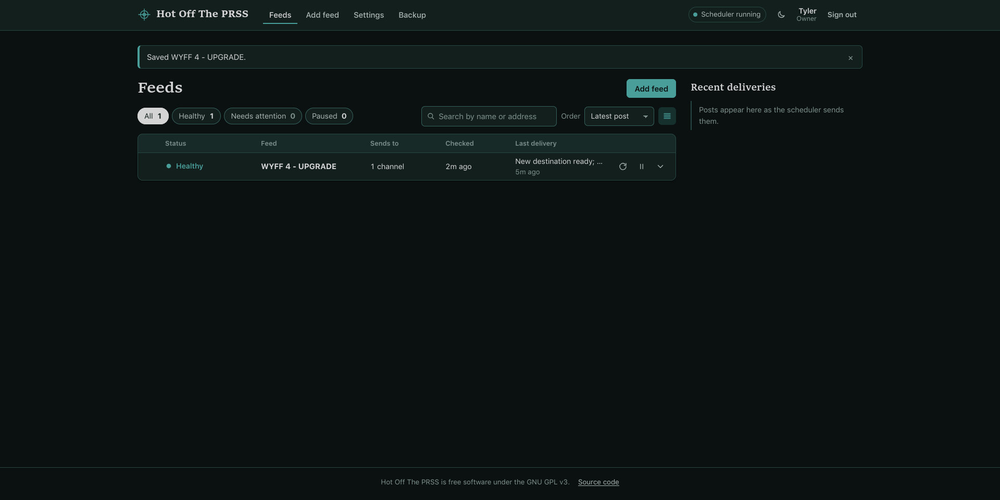
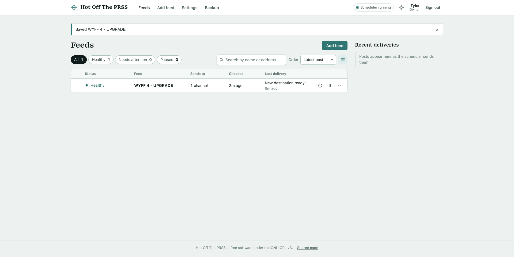

# Hot Off The PRSS

Hot Off The PRSS is a self-hosted relay that watches RSS and Atom feeds and posts new articles to Discord, Slack, Mattermost, Matrix, Telegram, ntfy, Gotify or any webhook, managed from a web dashboard.




## Features

- **Web dashboard** with live status, search, filters, drag-to-reorder (saved on the server), and light and dark themes.
- **Any mix of destinations.** One feed can post to any number of destinations, and one destination can receive any number of feeds. See [Destinations](#destinations).
- **Several sources per feed.** One feed can pull from several addresses (four sections of the same forum, say) with one set of cookies, schedule and destinations. An article that shows up in more than one source is posted once.
- **Feeds behind a login.** A feed can be fetched with cookies from a signed-in browser (a XenForo forum, for example) and a custom User-Agent.
- **Edit all.** Change the check interval, or pause and resume, for many feeds at once.
- **No backlog floods.** When a feed is first paired with a destination, everything already in the feed is marked as seen. Only articles that show up after that are posted.
- **No double posts.** See [How duplicates are prevented](#how-duplicates-are-prevented).
- **Recent deliveries log** showing what was posted where, and what failed and why.
- **Feed health.** Errors, timeouts, non-feed responses and permanent redirects are shown per feed, with a one-click switch to a moved feed's new address.
- **Preview and test tools.** Preview a feed before saving it, and send a test message to any destination from the form.
- **Roles.** Owner, Super Admin and Admin. Passwords are salted and hashed.
- **Backup and restore** of feeds and users as JSON.
- **Automatic upgrades.** Data from older versions is migrated on first start, with backups kept.

## How it works

Two processes run side by side:

- `main_web.py` is the Flask web UI, served by gunicorn.
- `scheduler.py` checks due feeds (several in parallel), posts new articles, and records results. Only one scheduler runs per data folder; a second one waits until the first stops.

They share a data folder:

| File | Contents |
|---|---|
| `config.json` | Feeds, destinations, intervals, feed order |
| `user.json` | Accounts with hashed passwords |
| `secret.key` | Session signing key |
| `prss_state.db` | SQLite: seen-article memory, feed health, delivery log, scheduler heartbeat |

The data folder is the project folder by default. Set `PRSS_DATA_DIR` to put it somewhere else (Docker uses `/data`).

## Running with Docker

Prerequisites:

- Docker with the Compose plugin, or Portainer.
- A folder on the host for the data. I use `/data/compose/hotofftheprss`.

Steps:

1. Clone the repository: `git clone https://github.com/NullAngst/HotOffThePRSS.git`
2. Open `HotOffThePRSS/Docker/docker-compose.yml` in nano, or whichever editor you prefer.
3. Change the left side of the `volumes:` line if your data folder lives somewhere else.
4. Set `PUID` and `PGID` to the user that should own the data files. Run `id -u` and `id -g` on the host to get yours. The default is 1000, since that is the first user on most Linux installs.
5. Start it: `cd HotOffThePRSS/Docker && docker compose up -d --build`
6. Open `http://<server>:5000` and create the Owner account.

The container starts as root only long enough to hand the data folder to `PUID:PGID`, then runs everything as that user. Set `PUID=0` if you really want it to stay root.

Logs: `docker logs -f hotofftheprss`

Update: `cd HotOffThePRSS && git pull && cd Docker && docker compose up -d --build`

Every build pulls the newest Python 3 image and the newest release of every package, since the compose file turns the build cache off. Builds take a little longer. In exchange nothing quietly goes out of date.

### Portainer

1. Stacks, Add stack, Build method: Repository.
2. Repository URL `https://github.com/NullAngst/HotOffThePRSS.git`, reference `refs/heads/main`, compose path `Docker/docker-compose.yml`.
3. Deploy.

To update, open the stack and choose Pull and redeploy.

Now the dashboard is up, the scheduler is checking feeds in the background, and the container reports healthy only while both are running.

## Running without Docker

Prerequisites:

- Python 3.10 or newer, with `venv`.
- A user to run it as. The examples use `your_user`.

Steps:

1. Clone the repository and `cd` into it.
2. Create a virtual environment: `python3 -m venv venv`
3. Install the dependencies: `venv/bin/pip install --upgrade -r Docker/requirements.txt`
4. Start the web UI: `venv/bin/gunicorn --bind 0.0.0.0:5000 --workers 2 --threads 4 --timeout 60 main_web:app`
5. In a second terminal, start the scheduler: `venv/bin/python scheduler.py`

To run it under systemd instead, create `/etc/systemd/system/hotofftheprss-web.service`:

```ini
[Unit]
Description=Hot Off The PRSS web UI
After=network-online.target
Wants=network-online.target

[Service]
User=your_user
WorkingDirectory=/home/your_user/HotOffThePRSS
ExecStart=/home/your_user/HotOffThePRSS/venv/bin/gunicorn --workers 2 --threads 4 --timeout 60 --bind 0.0.0.0:5000 main_web:app
Restart=always

[Install]
WantedBy=multi-user.target
```

and `/etc/systemd/system/hotofftheprss-scheduler.service`:

```ini
[Unit]
Description=Hot Off The PRSS scheduler
After=network-online.target
Wants=network-online.target

[Service]
User=your_user
WorkingDirectory=/home/your_user/HotOffThePRSS
ExecStart=/home/your_user/HotOffThePRSS/venv/bin/python scheduler.py
Restart=always
TimeoutStopSec=30

[Install]
WantedBy=multi-user.target
```

Then run `sudo systemctl daemon-reload && sudo systemctl enable --now hotofftheprss-web hotofftheprss-scheduler`.

DO NOT run a second scheduler against the same data folder, for example the Docker container and a systemd service pointed at one directory. The second one only waits, so nothing double posts, but nothing extra gets done either.

## Upgrading from an earlier version

Stop the old version, update the code, start the new one. Nothing needs converting by hand.

On first start the new version:

- Upgrades `config.json` to the current format (version 4). Legacy `webhook_url` and `webhook_urls` fields become `webhooks`, missing or duplicate feed ids are fixed, and every existing destination gets a service type. The original is kept as `config.json.pre-v4.bak`.
- Upgrades `prss_state.db` to schema 3, which records when each source was last downloaded in full. Feeds that are running carry on without re-seeding.
- Fixes `user.json` from the single-user era. The original is kept as `user.json.pre-v2.bak`.
- Imports `sent_articles.yaml` and `feed_state.json` from very old versions and renames them to `*.migrated`.
- Re-hashes each password with Werkzeug's current method the next time that person signs in.

Docker users: the container now runs as `PUID:PGID` (default 1000:1000) instead of root, and changes the owner of the files in the data folder on first start. If that folder is on a share where the owner can not be changed, it logs a warning and keeps running as root.

`convert_config.sh` is gone; the app converts old configs itself.

Rolling back works: rename any `*.migrated` files back and restore the newest `.pre-v*.bak` files. An older version started without them seeds every destination again, so it does not flood channels either.

## Using it

**Add a feed.** Enter the feed address and choose Preview to confirm it loads. Name is optional. Add one or more destinations, pick the service for each, and use Send test to confirm it works. Choose how often to check.

**Several sources.** In a feed's Source section, choose Add another source for each extra address. Every source uses the feed's name, cookies, User-Agent, schedule and destinations. When a source is added to a feed that is already running, its existing articles are marked as seen, not posted. One failing source does not stop the others from posting.

**Edit all.** The Edit all button on the dashboard changes the check interval, the active state, or both, for any set of feeds. Pick feeds by their current interval (hold Shift to add another interval group), filter by name, or select all.

**Status.**

| Status | Meaning |
|---|---|
| Healthy | Last check succeeded |
| Moved | The feed permanently redirects (301 or 308) to a new address. Open the row to switch to it |
| Error text | The last check failed; the text says why |
| Waiting for first check | Added but not checked yet |
| Paused | Skipped until resumed |

A red delivery message means the destination refused the post or could not be reached. A 401, 403 or 404 usually means a deleted webhook, a revoked token or a bot that lost access. Those articles stay queued and go out once the destination is fixed.

If Check now or Send test report that a request was redirected or blocked before it reached the app, something in front of it (Cloudflare Access, Authelia, Authentik, a firewall) intercepted it. Check now then falls back to a normal page submit, which follows the redirect.

**Check now** queues an immediate check. The dashboard updates when it finishes.

**Order.** Drag the handle on the left of a row, or focus it and use the arrow keys. The order is saved for everyone and included in backups.

## How duplicates are prevented

Why would an article post twice? Usually because the feed changed it slightly, or because the app could not tell whether a post went through. Here is what covers each case:

- **Changing ids.** Some feeds put a fresh tracking parameter (`utm_source=...`) in every link, or a new guid on every download. Each article is also remembered by its title plus publish date, and, for entries without a guid, its title plus link with tracking parameters, `www.` and the scheme stripped. A changed id alone no longer makes an article look new.
- **Posts that time out.** If a destination accepts a post but the answer never arrives, the article is not retried, since retrying would post it a second time. The delivery log says so. Matrix is the exception: it is retried with the same transaction id, which the homeserver drops if it already has it.
- **Crashes and database errors.** An article is recorded as sent before the request goes out. A clean failure removes the record so the next check retries it. A crash, a full disk or a locked database after the post can only lose that one post, never repeat it on every check.
- **Two feeds, one destination.** Feeds that share a destination take turns, so a shared article is posted once.
- **Two schedulers.** Only one scheduler runs per data folder.
- **Long pauses.** Memory of an article is dropped 30 days after the feed last showed it. A source that has not been read for about four weeks (paused, or failing) has its articles marked as seen again instead of posted, and every source is downloaded in full at least every 6 hours so a feed that only answers "not modified" keeps its memory fresh.
- **New destinations while a source is down.** A new destination is only set up once every source of the feed loads, so a source that comes back later can not post its backlog to it.

The trade-off: in the rare case of a lost answer, an article can be missed instead of posted twice. I prefer that. A missed post shows in the delivery log; a double post shows in everyone's channel.

## Destinations

| Service | What it needs | Where to get it |
|---|---|---|
| Discord | Webhook URL | Channel settings, Integrations, Webhooks |
| Slack | Webhook URL | A Slack app with Incoming Webhooks enabled |
| Mattermost | Webhook URL | Integrations, Incoming Webhooks. Rocket.Chat incoming webhooks also work |
| Matrix | Homeserver, room ID (`!id:server`) or alias (`#room:server`), access token | A separate bot account that has joined the room. Messages are sent as notices |
| Telegram | Bot token, chat ID (`-100...` or `@channel`) | @BotFather. The bot must be in the group, or an admin of the channel. Forum topics are not supported |
| ntfy | Topic URL, optional access token | ntfy.sh or your own server |
| Gotify | Server URL, application token | An application created in Gotify |
| Generic webhook | URL | Receives JSON: `feed`, `title`, `link`, `summary`, `published` (ISO 8601), `image` |

Each destination remembers what it has received on its own. If Discord rejects a post's embed (an odd image address, an overlong link), a plainer version is sent instead of dropping the article.

## Feeds that need a login

Some feeds only show everything to signed-in members. Open the feed's Access section and paste the site's cookies.

For a XenForo forum:

1. Sign in with Stay logged in ticked, ideally in a private window.
2. Open the browser's developer tools, then Storage (Firefox) or Application (Chrome), then Cookies, and copy `xf_user`. Adding `xf_session` does no harm.
3. Paste as `xf_user=...; xf_session=...` and choose Preview to confirm the feed loads.
4. To follow several sections, add each section's RSS address as another source on the same feed so they share the cookies.
5. Close the private window without signing out, since signing out invalidates the cookie.

The field also accepts one `name=value` per line, a cookies.txt export, or the JSON exported by browser cookie-editor extensions. Values are sent exactly as pasted.

Notes:

- Cookies are sent only to the feed's own host, never to a site it redirects to.
- If the site answers with a login page or a 401/403, the feed shows an error saying the cookies may have expired. Paste fresh ones.
- Changing a feed's cookies re-seeds its destinations, so threads that only appear once signed in are marked as seen instead of posted in a burst.
- Some sites tie a session to the browser that created it. If cookies alone do not work, also paste that browser's User-Agent.

## Roles

| Role | Feeds | Users | Backups |
|---|---|---|---|
| Owner | Yes | Everyone | Feeds and users |
| Super Admin | Yes | Admins only | Feeds |
| Admin | Yes | No | No |

The Owner can not be deleted or demoted. Changing or resetting a password signs that account out everywhere else. Repeated failed sign-ins are slowed down, per address and username and per address alone.

If `user.json` becomes unreadable, sign-in and first-time setup are both blocked until it is fixed, so nobody can create a new Owner over a damaged file. If `config.json` becomes unreadable, feeds can not be changed until it is fixed or a backup is restored, and the scheduler stops checking without touching any memory.

## Configuration

| Variable | Default | Purpose |
|---|---|---|
| `PRSS_DATA_DIR` | project folder | Where data files live |
| `PUID` / `PGID` | `1000` | Docker only. User and group the app runs as; `PUID=0` keeps root |
| `PRSS_SECURE_COOKIES` | `0` | Set to `1` when served over HTTPS |
| `PRSS_TRUST_PROXY` | `0` | Set to `1` only behind your own reverse proxy, so client addresses are read correctly |
| `PRSS_WORKERS` | `4` | Feeds checked in parallel |
| `PRSS_MAX_POSTS_PER_CHECK` | `20` | Per destination. Beyond this the oldest new articles are skipped and logged, which guards against a feed that suddenly changes all its article ids |
| `PRSS_USER_AGENT` | current Chrome | Default User-Agent for feed requests. The built-in one follows Chrome's release schedule by date, so it never needs a manual bump. A feed's own setting overrides it |
| `PRSS_TELEGRAM_API` | `https://api.telegram.org` | Only for a self-hosted Telegram Bot API server |
| `PRSS_BIND` | `[::]:5000` | Docker only. Address gunicorn listens on |

## Notes and limits

- Dated articles older than 24 hours are never posted. Undated articles are posted when they first appear after a feed is set up.
- A feed download is cut off after 20 seconds or 15 MB, whichever comes first.
- Config backups contain full webhook addresses, tokens and feed cookies. Treat them like passwords.
- The login throttle keys on client address. Behind a reverse proxy without `PRSS_TRUST_PROXY=1`, every client shares one address.
- Anyone with an account can make the server fetch any address through Preview, Send test or a feed. Only give accounts to people you trust with that.

Developers: `pip install pytest && python -m pytest tests` runs the test suite, which spins up a local feed and destination and checks the duplicate cases above. See `maintenance.md` for upkeep.
